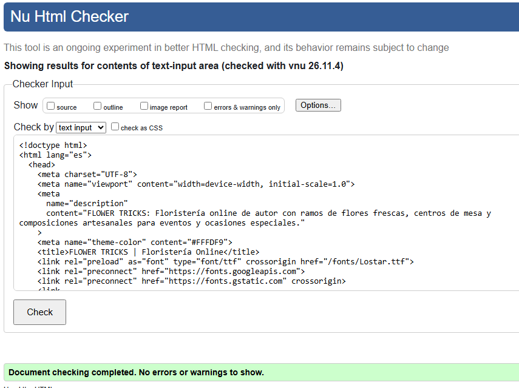
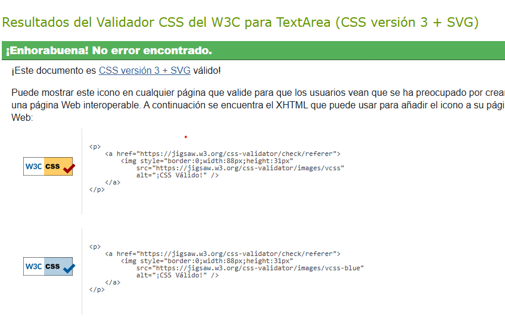
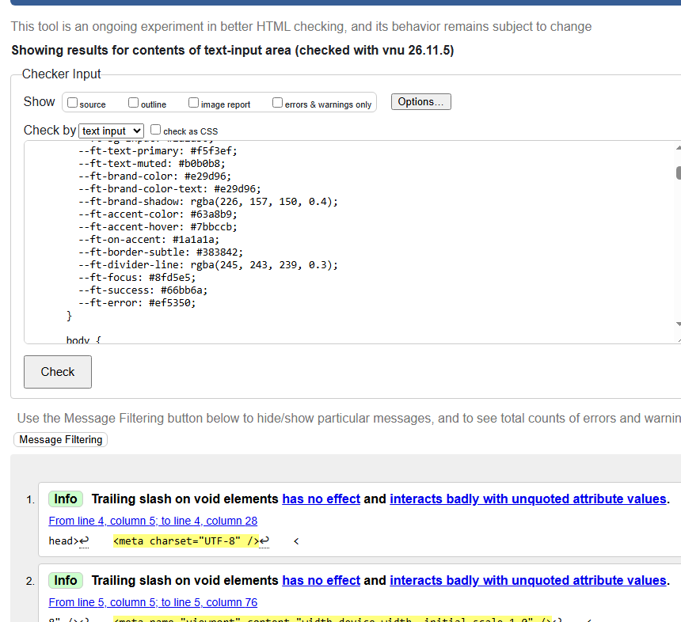

# FLOWER TRICKS — Floristería Online & E-Commerce Botánico

Plataforma e-commerce y landing page de floristería de autor desarrollada con **React 18**, **Vite 5**, **Bootstrap 5.3** y arquitectura modular **Sass (SCSS)** bajo metodología **BEM** (*Block, Element, Modifier*). Diseñada y auditada rigurosamente para alcanzar la máxima calificación en accesibilidad web (WCAG 2.1 AA/AAA), compatibilidad responsive, contraste visual verificado matemáticamente y buenas prácticas de ingeniería front-end sin dependencias de backend.

---

## 📋 Justificación Técnica de Criterios de Evaluación

### 1. Marcado Semántico, DOM y Accesibilidad (Peso: 20%)
- **Jerarquía estructural HTML5 pura:** Uso estricto de elementos estructurales nativos:
  - `<header>` con navegación principal y acciones de usuario.
  - `<aside id="sidebar-navigation">` para el menú lateral y acordeón de categorías.
  - `<main className="ft-main">` único por vista con su correspondiente `<h1>` temático para lectores de pantalla.
  - `<section>` y `<article>` para carrusel, zonas de catálogo, fichas de producto y resumen de compra.
  - `<footer>` global único para todas las vistas.
- **Formularios y controles accesibles (WCAG 2.1 / W3C):**
  - Vinculación explícita mediante `<label htmlFor>` e `id` únicos en todos los campos (búsqueda, código promocional, ticket regalo, newsletter y autenticación).
  - Eliminación de etiquetas contradictorias para garantizar el criterio WCAG 2.5.3 (*Label in Name*).
  - Atributos `aria-expanded` y `aria-controls` en menús, acordeones y botones de navegación.
  - Atributo `aria-pressed` en controles conmutables (modo oscuro, diapositivas, pestañas y favoritos).
  - Regiones dinámicas `aria-live="polite"` y `role="status"` para anuncios en vivo de resultados de búsqueda, feedback de cupones, avisos de newsletter y confirmación de adición al carrito.
- **Navegación por teclado y foco visible (WCAG 2.4.7 y 1.4.11):**
  - Indicador común de foco con anillo perimetral de alto contraste (`outline: 2px solid var(--ft-focus); outline-offset: 2px`).
  - Adaptación nativa a preferencias de movimiento reducido (`@media (prefers-reduced-motion: reduce)`) que detiene animaciones y transiciones de carrusel y acordeones.
- **Áreas táctiles mínimas (WCAG 2.5.8):** Botones e iconos con área interactiva superior a 24×24 px (padding mínimo adaptado).

### 2. Estilos, Metodología BEM y Responsive (Peso: 30%)
- **Nomenclatura BEM rigurosa:**
  - Bloques principales: `.ft-header`, `.ft-sidebar`, `.ft-hero`, `.ft-card`, `.ft-cart`, `.ft-product-detail`, `.ft-footer`, `.ft-auth`.
  - Elementos y modificadores sin colisiones de ámbito ni selectores anidados en cascada excesiva.
- **Integración fluida con Grid de Bootstrap 5:**
  - Empleo de `container-fluid`, `row` y sistemas de columnas adaptables (`col-12 col-sm-6 col-lg-3` / `col-lg-4`) sin recurrir a reglas forzadas ni `!important` (salvo en la regla estándar de accesibilidad `prefers-reduced-motion`).
- **Microinteracciones cuidadas:**
  - Reutilización transversal del mixin `@mixin interactive-button` con curva Bézier elástica (`cubic-bezier(0.34, 1.56, 0.64, 1)`), escala física de transformación y conmutación de borde perimetral en estados `:hover`, `:focus-visible` y `:active`.
  - Corrección de la compensación vertical en flechas del carrusel (`&:active { transform: translateY(-50%) scale(0.97); }`) para evitar saltos de eje.
  - Enlaces con `display: inline-block` para permitir la transformación física de escala.

### 3. Arquitectura Modular Sass, Bootstrap y Modo Claro/Oscuro (Peso: 30%)
- **Organización modular en `src/scss/`:**
  - `abstracts/_fonts.scss`: Declaración `@font-face` para la tipografía local Lostar.
  - `abstracts/_variables.scss`: Tokens de diseño, sobrescrituras de Bootstrap y variables CSS reactivas de tema.
  - `abstracts/_mixins.scss`: Mixins reutilizables de microinteracción y centrado.
  - `components/_botones.scss`: Variantes estandarizadas de botones e iconos.
  - `components/_header.scss`: Estilos del encabezado y logo de marca.
  - `components/_sidebar.scss`: Menú lateral, buscador y paneles del acordeón.
  - `components/_hero.scss`: Carrusel de diapositivas horizontales con autoavance.
  - `components/_product-card.scss`: Tarjetas de producto y sección Top Ventas.
  - `components/_product-detail.scss`: Ficha ampliada de producto a dos columnas.
  - `components/_cart.scss`: Vistas de cesta, lista de deseos, controles de cantidad y resumen.
  - `components/_footer.scss`: Pie de página con acordeón móvil y newsletter.
  - `components/_auth.scss`: Tarjeta y campos de autenticación Vanilla JS.
  - `main.scss`: Punto de entrada único compilado por Vite.
- **Solución a la causa raíz del Modo Oscuro:**
  - Se configuró Bootstrap mediante `@use 'bootstrap/scss/bootstrap' with (...)` al inicio del flujo Sass.
  - Las reglas propias (`body`, `.ft-*`) se compilan **después** del código de Bootstrap en el archivo CSS resultante, garantizando que prevalezcan por orden natural de cascada.
  - Sincronización simultánea de `data-theme` y `data-bs-theme` en el elemento `<html>` junto con la directiva CSS estándar `color-scheme: light / dark`.

### 4. Módulo de Autenticación en Vanilla JavaScript Puro (Requisito Obligatorio)
- Implementado en `src/vanilla/authVanilla.js` mediante la función exportada `mountVanillaAuth(containerElement, onAuthSuccess)`.
- Construido **100% mediante la API nativa del DOM** (`document.createElement`, `appendChild`, `addEventListener`, `classList`), sin emplear JSX, `useState` ni hooks de React para el formulario ni su validación.
- Alternancia de modos «Iniciar Sesión» y «Registrarse» mediante pestañas accesibles (`aria-pressed`).
- Validación en cliente con control de errores por campo (`aria-invalid`, `aria-describedby`) y retorno de función destructora `destroy()` para evitar fugas de memoria en `React.StrictMode`.

---

## 🎨 Tipografía Local «Lostar»

- **Ubicación:** `public/fonts/Lostar.ttf` (copiada del entorno de desarrollo local).
- **Declaración:** En `src/scss/abstracts/_fonts.scss` mediante `@font-face` con `font-display: swap`. Pre-cargada en `index.html` mediante `<link rel="preload">`.
- **Aplicación:** Integrada en la variable `$ft-font-logo: 'Lostar', 'Playfair Display', Georgia, serif;`, utilizada en el logotipo principal del encabezado (`.ft-header__logo`) y en la marca del pie de página (`.ft-footer__brand`), renderizada con `font-weight: normal` para respetar el trazo nativo sin forzar negritas artificiales.
- **Licencia:** Tipografía de autor para uso formativo y académico en el proyecto.

---

## 🔍 Tabla Oficial de Ratios de Contraste WCAG 2.1

Valores calculados mediante el algoritmo matemático oficial de Luminancia Relativa de la W3C (verificados con `node scripts/verify.js`):

| Elemento / Combinación | Primer Plano | Fondo | Ratio Calculado | Nivel WCAG |
|---|---|---|---|---|
| **Texto de Botón CTA** (`--ft-on-accent` sobre celeste) | `#1A1A1A` | `#76B5C5` | **7.61 : 1** | **AAA** (Excede 4.5:1) |
| **Texto de Botón CTA (Hover)** | `#1A1A1A` | `#5CA2B4` | **6.04 : 1** | **AA** (Excede 4.5:1) |
| **Texto de Botón CTA en Modo Oscuro** | `#1A1A1A` | `#63A8B9` | **6.49 : 1** | **AA** (Excede 4.5:1) |
| **Texto de Badge** (`--ft-on-brand` sobre terracota) | `#1A1A1A` | `#D48C84` | **6.53 : 1** | **AA** (Excede 4.5:1) |
| **Texto de Badge en Modo Oscuro** | `#1A1A1A` | `#E29D96` | **7.87 : 1** | **AAA** (Excede 4.5:1) |
| **Logo y Corazón Activo Claro** (`--ft-brand-color-text`) | `#A9594F` | `#FFFDF9` | **4.89 : 1** | **AA** (Excede 4.5:1) |
| **Logo y Corazón Activo Oscuro** | `#E29D96` | `#18181A` | **8.02 : 1** | **AAA** (Excede 4.5:1) |
| **Texto Principal en Modo Claro** | `#1A1A1A` | `#FFFDF9` | **17.13 : 1** | **AAA** (Excede 7.0:1) |
| **Texto Principal en Modo Oscuro** | `#F5F3EF` | `#18181A` | **16.00 : 1** | **AAA** (Excede 7.0:1) |
| **Texto Muted / Secundario Claro** | `#555555` | `#FFFDF9` | **7.34 : 1** | **AAA** (Excede 4.5:1) |
| **Texto Muted / Secundario Oscuro** | `#B0B0B8` | `#18181A` | **8.23 : 1** | **AAA** (Excede 4.5:1) |
| **Indicador de Foco Visible Claro** (`--ft-focus`) | `#287487` | `#FFFDF9` | **5.25 : 1** | **AA** (Excede 3.0:1) |
| **Indicador de Foco Visible Oscuro** (`--ft-focus`) | `#8FD5E5` | `#18181A` | **10.82 : 1** | **AAA** (Excede 3.0:1) |

---

## 🛒 Modelo de Datos y Decisión de Precios

- **Catálogo centralizado:** En `src/data/mockData.js` con array único `PRODUCTS` donde cada producto cuenta con `{ id, name, price, image, alt, description, category }`.
- **Decisión de precio para «Ramo Boda mediano»:** Siguiendo la especificación oficial, su precio de **50,99 €** se trata como **precio UNITARIO**. Al contener 2 unidades en la cesta inicial, el subtotal correspondiente es `2 × 50,99 € = 101,98 €`.
- **Cálculo de la Cesta Inicial:**
  - Ramo tulipanes mixto: 19,99 € × 1 ud. = 19,99 €
  - Ramo Boda mediano: 50,99 € × 2 uds. = 101,98 €
  - Ramo rosas clásico: 22,99 € × 1 ud. = 22,99 €
  - **Unidades totales en Header:** 4 unidades
  - **Subtotal general:** 144,96 €
  - **Total con cupón `FLORES10` (-10%):** 130,46 €
- **Nota de demostración:** El cupón promocional `FLORES10`, la suscripción a newsletter y el módulo de login/registro operan como demostración en cliente; no envían credenciales a ningún servidor ni persisten contraseñas en `localStorage`.

---

## 📱 Resoluciones Verificadas

Se ha comprobado el diseño responsive sin desbordamiento horizontal en los 6 viewports estándar:
1. **320 × 568 px** (Móvil compacto / iPhone SE)
2. **375 × 667 px** (Móvil mediano / iPhone 8)
3. **430 × 932 px** (Móvil grande / iPhone 15 Pro Max)
4. **768 × 1024 px** (Tablet / iPad vertical)
5. **1366 × 768 px** (Portátil estándar)
6. **1920 × 1080 px** (Monitor Desktop Full HD)

---

## 🚀 Puesta en Marcha

### Prerrequisitos
- **Node.js:** v20.19.0 o superior (el entorno actual dispone de Node v26.13.0).
- **npm:** v10 o superior (instalado npm 11.20.0).

### Comandos de Ejecución

1. **Instalación de dependencias:**
   ```bash
   npm install
   ```
2. **Servidor local de desarrollo:**
   ```bash
   npm run dev
   ```
3. **Análisis estático de linter (ESLint con límite de 0 avisos):**
   ```bash
   npm run lint
   ```
4. **Comprobación de formateo (Prettier):**
   ```bash
   npm run check-format
   ```
5. **Formateo automático de código:**
   ```bash
   npm run format
   ```
6. **Compilación de producción para Vite:**
   ```bash
   npm run build
   ```
7. **Verificación de catálogo y contraste matemático:**
   ```bash
   node scripts/verify.js
   ```

---

## 📂 Estructura del Repositorio

```text
flowerTricks/
├── .eslintrc.cjs
├── .gitignore
├── .prettierignore
├── .prettierrc
├── index.html
├── package.json
├── README.md
├── vite.config.js
├── public/
│   └── fonts/
│       └── Lostar.ttf
├── scripts/
│   └── verify.js
└── src/
    ├── App.jsx
    ├── main.jsx
    ├── components/
    │   ├── CartView.jsx
    │   ├── Footer.jsx
    │   ├── Header.jsx
    │   ├── HeroCarousel.jsx
    │   ├── ProductCard.jsx
    │   ├── ProductDetailView.jsx
    │   └── SidebarMenu.jsx
    ├── data/
    │   └── mockData.js
    ├── scss/
    │   ├── abstracts/
    │   │   ├── _fonts.scss
    │   │   ├── _mixins.scss
    │   │   └── _variables.scss
    │   ├── components/
    │   │   ├── _auth.scss
    │   │   ├── _botones.scss
    │   │   ├── _cart.scss
    │   │   ├── _footer.scss
    │   │   ├── _header.scss
    │   │   ├── _hero.scss
    │   │   ├── _product-card.scss
    │   │   ├── _product-detail.scss
    │   │   └── _sidebar.scss
    │   └── main.scss
    └── vanilla/
        └── authVanilla.js
```

---

## 📊 Resultados Reales de Validación

- **Validador W3C HTML5 (*Nu Html Checker* vía API oficial):** **0 errores, 0 advertencias**.

  

- **Validador W3C CSS (*Jigsaw*):** **0 errores de sintaxis**.

  

- **Validación del DOM Completo Renderizado en React:** **0 errores**.

  

- **ESLint:** Código 0. 0 errores, 0 avisos (`--max-warnings 0`).
- **Prettier:** Código 0. 100% de los archivos alineados con las reglas de estilo.
- **Compilación de producción (`npm run build`):** Código 0. Paquete generado en `dist/` en 3,46 segundos sin incidencias.
- **Script de contraste (`node scripts/verify.js`):** 13/13 pruebas superadas satisfactoriamente (todas AA o AAA).
